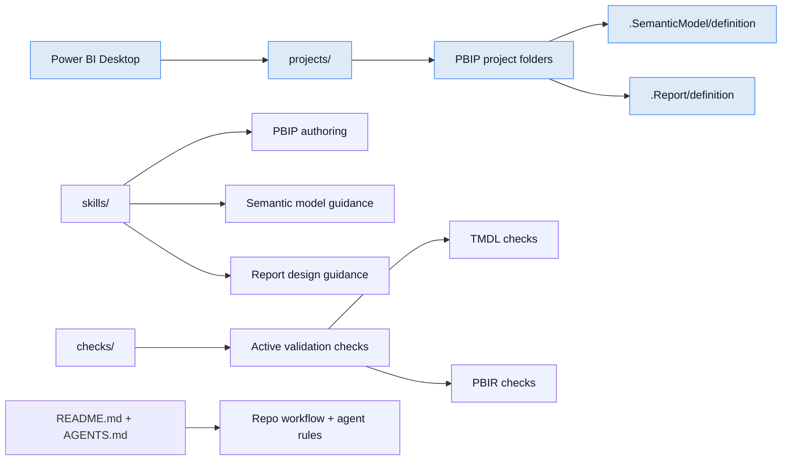

# Overview

This repo is organized around the current PBIP-first workflow: work directly in the project files, then validate with the repo's existing checks. `skills/` provides the guidance, and `checks/` contains the validation scripts already in place.

## High-level architecture

## Existing workflow

1. Put a project in `projects/`.
2. Read the brief and the relevant TMDL/PBIR files.
3. Edit the semantic model and report files directly in the project.
4. Validate in Power BI Desktop and run the repo checks in `checks/pbip/`.
5. Tell the agent to run the relevant check script after each edit batch so it can flag any errors it introduced.
6. Use `skills/` as the reference for DAX, Power Query, PBIR, and TMDL conventions.

## Repo responsibilities

- `projects/` — the active PBIP development area
- `skills/` — authoring guidance and design conventions
- `checks/` — the validation checks already in place
- `README.md` and `AGENTS.md` — repo operating guidance

## Key point

This repo is currently a PBIP-first workbench with validation checks already active. The primary editing contract is direct work inside the project files. Hook wiring and vendor-specific automation are a future next step, not part of the current baseline workflow.
